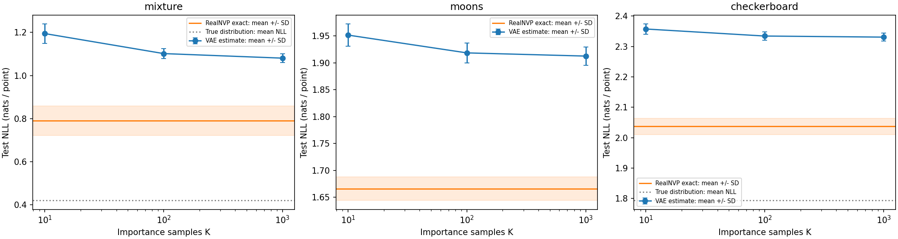
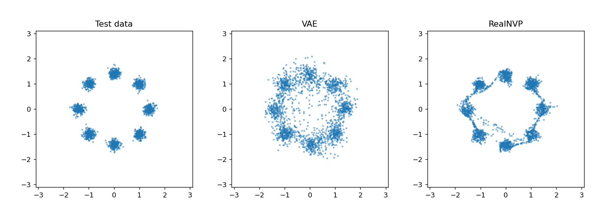
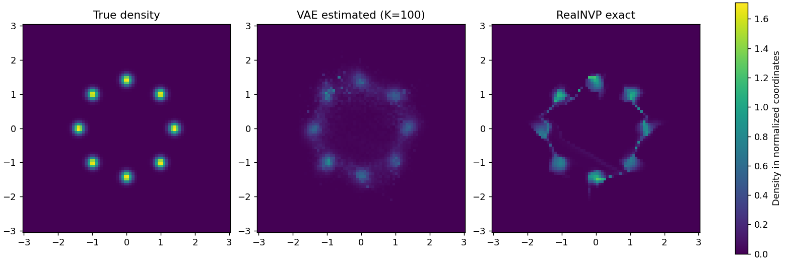
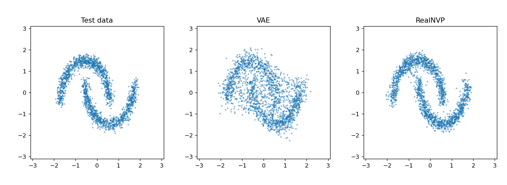
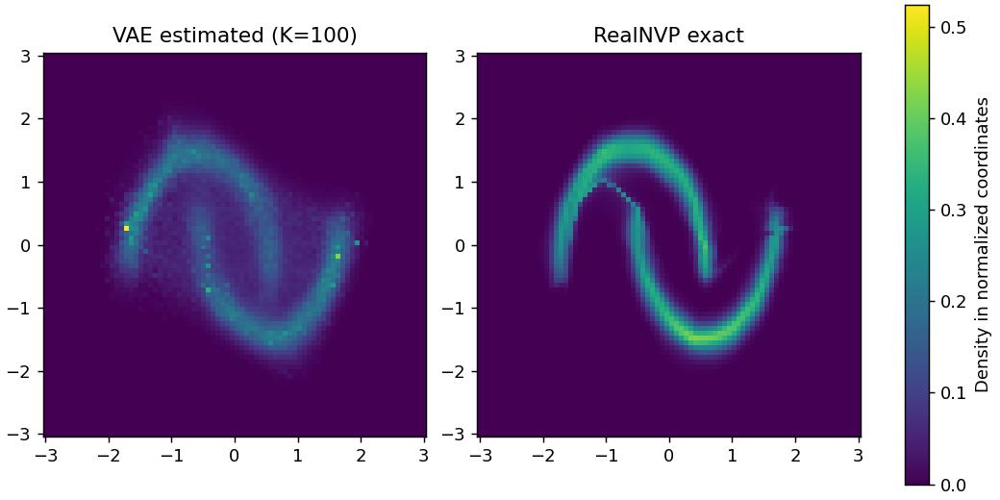
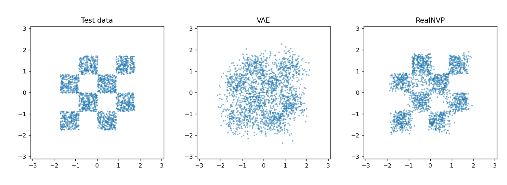
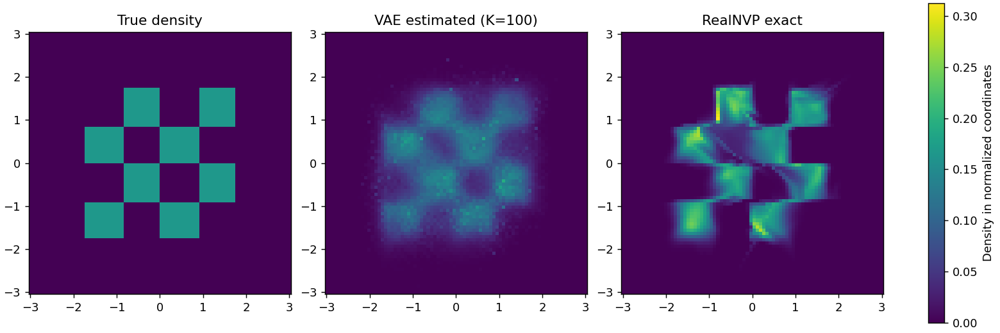

# Five-seed baseline study

Completed on CPU: 3 datasets x 5 seeds x 2 models, each trained for 100 epochs. These are measured results, not targets.

| Dataset | VAE estimated NLL, K=1000 | RealNVP exact NLL |
|---|---:|---:|
| mixture | 1.0807 +/- 0.0203 | 0.7907 +/- 0.0687 |
| moons | 1.9126 +/- 0.0172 | 1.6659 +/- 0.0221 |
| checkerboard | 2.3307 +/- 0.0130 | 2.0371 +/- 0.0271 |

Values are mean +/- sample SD across five paired data/model seeds, in nats per normalized 2D point. VAE estimates remain finite-K approximations.

## Findings and limits

- RealNVP has lower mean test NLL than the K=1000 VAE estimate on these three datasets. This compares the stated architectures and budgets, not all flows and VAEs.
- Both models cover all eight mixture modes in every seed under the documented threshold. In-mode fraction is more discriminating: VAE mean 61.45%, RealNVP mean 87.03%. Mode coverage alone hides samples between clusters.
- The VAE estimate improves as K increases in these aggregated measurements; this does not prove its true likelihood has been recovered.
- RealNVP has 27,672 parameters versus 9,094 for the VAE. The comparison is not capacity-matched. VAE observation variance is fixed at 0.01.
- These are synthetic-data results. Architecture ablation commands are provided, but full ablation studies have not been run. No claim about real-world datasets follows.

## Inspect the evidence

[Full NLL table](REPORT.md), [per-seed metrics](metrics.csv), [summary including timings and mode metrics](summary.json), [configuration](config.json), [environment](environment.json).

The examples below use seed 0, selected in advance rather than the best-performing seed. PNGs for every seed and all checkpoints are generated by the runner; only these representative plots and compact metrics are committed.

### mixture

### moons

### checkerboard

## Validation performed

- Five mathematical tests passed: flow inverse/Jacobian, VAE gradients and latent dimensions, known-density importance estimate, split isolation/normalization, and mode metrics.
- Two-seed smoke run completed on all datasets with K=10/100/1000.
- Alternate latent dimension 4 and flow depth 2 completed a smoke run; a repeated seeded run produced exactly identical metrics apart from timing.
- Full baseline completed all 30 fits and 60 metric rows; report plots were inspected.

Reproduce with `python benchmark.py --output benchmark_results/baseline`. Use a fresh output directory. See [protocol](../../BENCHMARK.md).
